# Architekturentscheidung ADR-001 — isolierter Raster-Editor

## Ausgangslage und kritische Bewertung

Die vorhandenen Branches wurden lesend untersucht, nicht als Produkt-Release oder freigegebener Laufzeitnachweis interpretiert:

| Quelle | Befund | Konsequenz |
|---|---|---|
| `fix/pro53-geometry-verify-20261025`, `063ba097f8de3968c0e82e3fb31ebca0c5fd899b` | Der Manager findet einen jBridge-Prozess und hängt einen projektspezifischen nativen Renderer-Hook an. Der Rückbau muss Renderer **und** ursprüngliche Fenstergeometrie restaurieren; bei Fehlern bleibt der Manager absichtlich aktiv. | Sinnvolles enges Kompatibilitätsexperiment, aber kein eigenständiger universeller VST3-Host. Externe Prozess-/Fenstertopologie und versionsabhängige Eingriffe erschweren Lebenszyklus und Rückbau. Keine Änderung daran. |
| `rewrite/vst2-host-core`, `588b83aa86e608ac282e43486a1f8a605e42c6d3` | Gute Trennung x64-Proxy/x86-Host, normale Win32-Nachrichtenpumpe, dokumentierte Echtzeitgrenzen. Die frühere GDI-Erfassung antwortet über den Kontrollkanal; der VST3-Adapter enthält lediglich die SDK-Versionsangabe. | Host-Lebenszyklusregeln beibehalten, Bildübertragung eigenständig vom Kontrollkanal entkoppeln und tatsächliche VST3-Schnittstellen implementieren. |
| Engineering-Guardrails `b6df84b0a04d01e240cff745ccebf60d67750486` | Gegenseitige GUI-/Audio-Sperren, Parameter-Vollabfragen pro Mausbewegung, unvollständige Capture-/Koordinatenverträge und irreführende PASS-Marker sind dokumentierte Fehlerklassen. Einige frühe Hinweise werden später korrigiert, z. B. VST2-MIDI-`byteSize=24` trotz 32 Byte Speicherlayout. | Keine Übernahme widersprüchlicher Regeln ohne Abgleich. Keine Vollabfragen bei Gesten; unabhängiger Audio-Worker; signed Drag-Koordinaten; echte PCM- und Bildpixel-Orakel. |

Es liegen keine autorisierten Pro-53-/FM7-Binärdateien und keine Studio-One-Instanz in dieser Maschine vor. Deshalb keine behauptete Laufzeitanalyse der alten kommerziellen Plugins und kein Vergleich vermeintlicher Klangverbesserungen.

## Verfahren im Vergleich

| Verfahren | Stärken | Grenzen / Entscheidung |
|---|---|---|
| Native Editor-Skalierung / VST3 Content Scale | Plugin kann höher aufgelöst rendern und eigene Eingabe konsistent behandeln. | Nur bei tatsächlicher Plugin-Unterstützung; legacy VST2 oft ohne Vertrag. Geplanter erster Kandidat pro Profil, noch nicht implementiert. |
| Windows Graphics Capture + D3D11 | GPU-kompatible Erfassung, Präsentation und Filter skalierbar. | Frame-/Fensterzugriff, occlusion/minimize, Adapter-/Geräteverlust; löst Eingabe und native Popups nicht automatisch. Geplantes Backend, kein vorhandenes Feature. |
| GDI-/Win32-Hooks | Kann für klar bekannte Renderer native Koordinaten konsistent virtualisieren. | `GetCursorPos`, Capture, Unterfenster, DPI und API-Umleitungen hängen eng zusammen; externe Hooks brauchen schwierigen Rückbau. Im neuen Prototyp **keine Hooks/Injection**. |
| GDI-Rastererfassung im eigenen Helper | Vollständiges Originalbild für kooperierende Software-Editoren, keine fremden Prozesse patchen, einfach messbar. | Kein universelles Rendering, kein Ersatz für GPU-Capture. Als explizites erstes Kompatibilitätsverfahren implementiert. |
| Separates natives Helper-Fenster | Original-Eingabe/Popups können unverändert bleiben. | Noch keine vergrößerte integrierte Oberfläche. Sinnvoller künftiger Fallback, derzeit nicht als auswählbarer Modus implementiert. |

FM8.plus aktiviert beim neueren FM8 dessen vorhandene interne DPI-Schicht; ältere Builds benötigen versionsspezifische Anpassungen. Seine behauptete FM8-Kompatibilität lässt keinen Schluss auf fremde Editor-Toolkits zu. Allgemeine Pixel-/Koordinatenkonzepte sind Forschungsinput; kein GPL-Code wurde importiert oder portiert.

## Implementierter Datenfluss

```mermaid
flowchart LR
  DAW[Windows x64 VST3 Host] --> Proxy[VST3 Component + Controller]
  Proxy -->|vordefinierte Audio-/Event-Pakete| Worker[Helper Audio-Worker]
  Worker --> Adapter[VST2- oder VST3-Adapter]
  Adapter --> Plugin[Original-Plugin]
  Proxy -->|Kontrolle bei deaktivierter Verarbeitung| UI[Helper GUI-Thread]
  UI --> Plugin
  Plugin --> Native[Originaler nativer Editor]
  Native -->|WM_PRINTCLIENT / PrintWindow| Pixels[Separater Bildpuffer]
  Pixels --> Surface[Proxy-Skalierungsfläche]
  Surface -->|asynchroner Eingabering| UI
```

Ein Helper pro Instanz; x86 und x64 verwenden dasselbe versionierte, pointerfreie Shared-Memory-Layout mit Compile-Time-Prüfungen. Die DAW lädt nur den eigenen VST3-Proxy. Ein Windows Job mit `KILL_ON_JOB_CLOSE` bindet die Prozesslebenszeit an die Wrapper-Instanz. Ein abgestürzter oder ausgefallener Helper hinterlässt disconnected/silent statt erneuter automatischer Zustellung der fehlerhaften MIDI-Nachricht.

Audio nutzt vorallokierte Stereo-Puffer und höchstens 256 Events. VST2-Parameter/Noten teilen den Block an den Sample-Offsets; VST3 erhält Parameterqueues mit den originalen Ziel-IDs und Ereignis-Offsets. UI-Bild und UI-Eingabe besitzen andere Speicherbereiche. Der Audio-Pfad wartet niemals auf ein Bild, eine Mausantwort oder eine gewöhnliche Kontrolltransaktion.

**Bewusste Prototyp-Grenze:** Audio verwendet noch einen synchronen, begrenzten Audio-Rendezvous, keinen fertigen latenzkompensierten asynchronen Ring. Timeout: `ceil(Blockdauer in ms)`, mindestens 1 ms; bei Timeout dauerhaft getrennt. Das kann bei winzigen Blöcken oder Systemlast die Audiodeadline überschreiten. Ein bestandener 1024-Sample-Test qualifiziert nicht 32/64-Sample-ASIO-Betrieb. Für die nächste Stufe ist ein fester interner Audio-Quantum-Ring mit explizit gemeldeter Pipeline-Latenz und eigenem Offline-Modus zu bewerten; keine spontane Latenzänderung pro Hostblock.

## Bild, Eingabe, Fenster

Der Originaleditor bleibt in einem eigenen, gleichbittigen Win32-Container. Die Proxy-Oberfläche liest eine auf etwa 60 Hz begrenzte Bildpublikation. Capture findet auf dem Helper-GUI-Thread statt; der Proxy überspringt belegte Frames. Kein synchroner Capture-RPC pro Mausbewegung.

Alle Größen werden neu aus unveränderlichen nativen Abmessungen berechnet: `round(native * percent / 100)`. Ganze Faktoren kopieren Pixel exakt; Zwischenstufen verwenden eine unabhängig geschriebene Kombination aus ganzzahliger Nearest-Vergrößerung und bilinearer Abtastung. Das stellt keine neue Detailinformation her; „höhere Auflösung“ wird nicht behauptet. Änderungen gehen über `IPlugFrame::resizeView`; Ablehnung erhält den alten Maßstab. Die Auswahl berücksichtigt die Arbeitsfläche des aktuellen Monitors mit Platzreserve für Fensterrahmen/Toolbar.

Der Proxy hält Mouse Capture für Nachrichteneingabe. Der Eingabering übersetzt signed Client-Koordinaten zurück zur nativen Fläche und an das tatsächliche Kindfenster; aktive Drags bleiben außerhalb des Editors ungeklemmt. Tastatur und Mausrad werden ebenfalls geroutet. Der Testeditor arbeitet mit diesen Nachrichten. **Nicht gelöst:** Renderer, die `GetCursorPos` abfragen, eigenen nativen Capture erzwingen, Raw Input/relative Pointer verwenden oder separate Popup-/Modalfenster erzeugen. Nachrichtenübersetzung kann deren Betrieb nicht vortäuschen. Native Popup-Menüs und Fokus über reale DAW-/Prozessgrenzen brauchen eigene Nachweise.

## Zustand und Automation

Wrapper-State trägt Version, Plugin-ID, Maßstab und höchstens 1 MiB Payload. Trunkierte/zu große/falsch versionierte/fremde Wrapperzustände werden vor einer Plugin-Mutation abgelehnt. VST2-Chunks werden übernommen oder Programme/Parameter gesichert; VST3 nutzt `IBStream`. Die Testfixtures weisen die tatsächliche Audiowiederherstellung nach. Ein fremdes Plugin kann selbst einen ungültigen Chunk teilweise anwenden; dafür gibt es noch keine allgemeine transaktionale Rücknahme.

State und Konfiguration werden bei deaktivierter Verarbeitung auf dem Helper-GUI-Thread ausgeführt, nicht gleichzeitig zum DSP. Live-State und Recovery mit transparenter State-Wiederherstellung fehlen. Parameter-IDs nach außen sind für eine feste Zielkonfiguration stabile Ordinalnummern; native VST3-IDs werden im Adapter übersetzt. Der GUI-Werttransport ist O(1) je geändertem Wert und ohne Vollscan des Plugins. Der Proxy meldet koaleszierte Änderungen als kurze begin/perform/end-Gesten; **die ursprüngliche Gestendauer ist noch nicht identisch abgebildet**. MIDI-CC, Pitchbend, polyphoner Ausdruck, SysEx, MIDI-Ausgabe, Preset-Browser und Transport-/Tempo-Kontext sind keine erfüllten Verträge dieses Stands.

Vor universeller Freigabe: persistente, überprüfbare Profile pro Plugin/Version und separater nativer Eingabe-/Popupmodus; vollständigere Host-Callbacks und Bus-/Parameter-Metadaten; Live-State und Crash-Recovery; echte ASIO-Messungen; Validator, Windows 11 und Studio One mit autorisierten x86/x64-Plugins.
